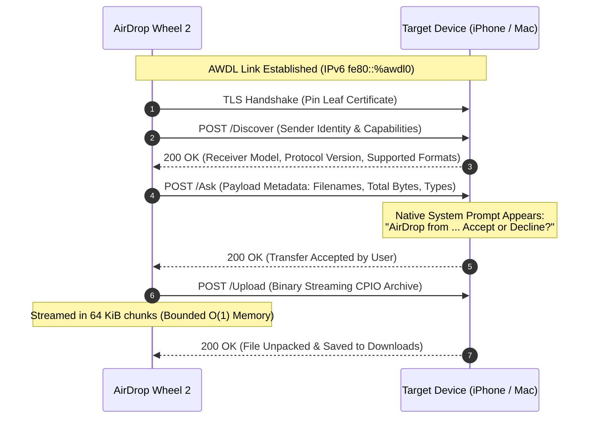

# Technical Architecture & AirDrop Protocol Specification

This document provides a comprehensive technical overview of **AirDrop Wheel 2**, covering the peer discovery mechanism, TLS leaf certificate pinning, network transport endpoints, archive streaming formats, and radial UI geometry.

---

## 1. System Architecture Overview

```text
               ┌────────────────────────────────────────────────────────┐
               │                      WheelOverlay                      │
               │   • Full-screen NSWindow (level: .floating + 1)        │
               │   • 35% adaptive dimming backdrop                      │
               │   • EventTap / mouseDragged coordinate tracker        │
               └───────────────────────────┬────────────────────────────┘
                                           │
                                           ▼
               ┌────────────────────────────────────────────────────────┐
               │                     WheelView (UI)                     │
               │   • 540px outer diameter, 8 radial sectors             │
               │   • Polar coordinate resolver: θ = atan2(dy, dx)       │
               │   • Dynamic readout hub (190px diameter)              │
               │   • Adaptive brand colors: #FEF6EA & #003D6C           │
               └───────────────────────────┬────────────────────────────┘
                                           │
                                           ▼ (On sector flick & release)
               ┌────────────────────────────────────────────────────────┐
               │                  TransferCoordinator                   │
               │   • Strict state machine:                              │
               │     pending → asking → accepted → uploading → done     │
               │   • Preflight permission validation (TCC)              │
               │   • Bounded memory buffer pipeline                     │
               └───────────────────────────┬────────────────────────────┘
                                           │
                    ┌──────────────────────┴──────────────────────┐
                    ▼                                             ▼
┌───────────────────────────────────────┐ ┌───────────────────────────────────────┐
│          RecipientDiscovery           │ │            AirDropProtocol            │
│ • NWParameters bound to awdl0         │ │ • TLS Handshake with Leaf Pinning     │
│ • NWBrowser for _airdrop._tcp         │ │ • POST /Discover                      │
│ • IPv6 link-local resolution          │ │ • POST /Ask                           │
│ • Dynamic hardware model extraction   │ │ • POST /Upload (POSIX ODC CPIO)       │
└───────────────────────────────────────┘ └───────────────────────────────────────┘
```

---

## 2. AirDrop Protocol & Network Engine

AirDrop Wheel 2 uses a pure Swift networking stack built on Apple's `Network.framework` (`NWBrowser`, `NWConnection`), with zero external dependencies.

### 2.1 Apple Wireless Direct Link (AWDL) Binding
AirDrop on Apple devices operates over **AWDL** (`awdl0`), a proprietary Wi-Fi peer-to-peer mesh interface.
- Standard Bonjour queries on `en0` (infrastructure Wi-Fi) may fail or introduce routing latency.
- In `RecipientDiscovery.swift`, the `NWParameters` explicitly binds to the `awdl0` network interface and enables peer-to-peer flags:
  ```swift
  parameters.includePeerToPeer = true
  if let awdl = NWInterface.InterfaceType.wifi.interfaces.first(where: { $0.name == "awdl0" }) {
      parameters.requiredInterface = awdl
  }
  ```

### 2.2 Bonjour Service Resolution
- Service Type: `_airdrop._tcp`
- Domain: `local.`
- Each discovered endpoint returns an IPv6 Link-Local address (e.g. `[fe80::1234:5678:9abc:def0%awdl0]:port`).
- TXT Record Attributes:
  - `flags`: Advertised state (e.g., discoverable by Contacts vs Everyone).
  - `model`: Device model identifier string (e.g., `iPhone15,2`, `MacBookPro18,1`).

### 2.3 TLS Leaf Certificate Pinning
To maintain security without querying Apple's private identity cloud:
1. When connecting to the peer's Link-Local HTTPS port, a self-signed or Apple-ad-hoc TLS certificate is presented.
2. During the initial `POST /Discover` exchange, AirDrop Wheel 2 extracts and pins the remote peer's **Leaf Certificate Public Key**.
3. For subsequent connections (`/Ask` and `/Upload`), the TLS validation verifies that the presented certificate matches the pinned key.
4. This ensures that even on an untrusted Wi-Fi channel, no man-in-the-middle entity can hijack the session between approval and payload transfer.

### 2.4 HTTP Protocol Sequence



---

## 3. Streaming Archive Format (CPIO)

To ensure interoperability with Apple's native AirDrop daemon (`sharingd`), files must be packed in a compliant CPIO archive.

### 3.1 POSIX ODC & SVR4 newc Compliance
AirDrop Wheel 2 implements pure Swift byte-level packaging:
- **Header**: Standard POSIX ODC (Octal format `070707`) or SVR4 newc (`070701`).
- **File Mode**: Regular file permissions (e.g., `0100644`).
- **Trailer**: An explicit `TRAILER!!!` record terminating the archive.
- **Padding**: Header and file data padded to 4-byte boundaries.

### 3.2 Bounded Constant Memory ($O(1)$)
Rather than loading an entire 5 GB file into an in-memory `Data` object before sending:
1. `TransferPayload` opens an `InputStream` or file descriptor.
2. The CPIO header is generated and emitted first.
3. File contents are read and dispatched across `NWConnection` in **64 KiB chunks**.
4. Memory usage remains constant ($< 15 \text{ MB}$) regardless of payload size.

---

## 4. Radial Wheel Math & UI Geometry

The wheel interface in `WheelView.swift` is designed with strict geometric precision:

```text
                  -Y (90°)
                     ▲
                     │
           Sector 1  │  Sector 0
       (-135° to -90°)│ (-90° to -45°)
                     │
-X (180°) ───────────┼───────────► +X (0°)
                     │
           Sector 2  │  Sector 7
       (-180° to -135°)│ (0° to 45°)
                     │
                     ▼
                  +Y (270°)
```

### 4.1 Polar Coordinate Mapping
For any cursor position $(x, y)$ relative to wheel center $(x_0, y_0)$:
$$\Delta x = x - x_0, \quad \Delta y = y - y_0$$
$$r = \sqrt{\Delta x^2 + \Delta y^2}$$
$$\theta = \text{atan2}(\Delta y, \Delta x)$$

### 4.2 Distance Zones
- **Deadzone ($r < 110\text{px}$)**: No sector is highlighted. Prevents accidental firing upon initial popup.
- **Inner Readout Hub ($r < 145\text{px}$)**: Displays source file icon, file name, and file size.
- **Sector Ring ($145\text{px} \le r \le 270\text{px}$)**: Divided into 8 equal sectors ($45^\circ$ or $\frac{\pi}{4}\text{ rad}$ each).
- **Infinite Projection ($r > 270\text{px}$)**: Because the `WheelOverlay` covers the entire screen with a 35% dimming layer, cursor fling gestures outside the outer ring still map to the correct sector angle.

---

## 5. Total Silence Invariant

AirDrop Wheel 2 enforces an architectural rule of **Total Silence**:
- No `.wav`, `.mp3`, `.m4a`, or `.aiff` files exist in the repository.
- No system sound libraries (`AVFoundation`, `AudioToolbox`, `AppKit.NSSound`, `AudioServicesPlaySystemSound`) are linked.
- All state transitions (accepted, uploading, completed, declined, failed) are conveyed exclusively through visual micro-animations in the lightweight `TransferHUD`.
